# 터미널 알림 v1

- 기록: 2026-10-12 · 부건 (Claude와 대화하며 정리)
- 범위: 결정 사항이 바뀌었을 때 Claude Code 터미널에 뜨는 알림 (착수 문서 T2~T5). T1 결정 사항 등록은 들어 있지 않아요.
- 이 버전으로 한 일: 터미널 사내 테스트 스크립트(`test_run.py`)를 만들었고, 실제 테스트는 웹 테스트 페이지로 진행 (끝까지 진행 3명)
- 다음 버전: [5장](#5-그래서-어떻게-개선할까)의 개선안을 반영해 `v2/`로 남겨요

| 장                                                     | 내용                                                       |
| ------------------------------------------------------ | ---------------------------------------------------------- |
| [1. 화면](#1-화면)                                     | 참가자가 본 화면 (캡처 15장), 실제 터미널 시안 화면 (11장) |
| [2. 어떻게 만들었나](#2-어떻게-만들었나)               | 터미널 시안과 웹 테스트 페이지 구성                        |
| [3. 이렇게 만든 이유](#3-이렇게-만든-이유)             | 화면 요소마다 정한 것과 이유                               |
| [4. 받은 피드백](#4-받은-피드백)                       | 숫자와 참가자 의견                                         |
| [5. 그래서 어떻게 개선할까](#5-그래서-어떻게-개선할까) | 바로 고칠 것, 팀이 정할 것                                 |

---

## 1. 화면

캡처는 두 벌이에요.

- **1-1~1-9 참가자가 본 화면 (`screens/web/`)**: 웹 테스트 페이지(`web-test/index.html`)를 Chrome에서 같은 순서로 진행하며 찍었어요. 피드백은 모두 이 화면을 보고 나왔어요.
- **1-10 실제 터미널 시안 화면 (`screens/terminal/`)**: `notice.py`가 내보내는 hooks 글을 그대로 터미널 색으로 그렸어요. 웹 테스트에 없던 화면(여러 건이 이어지는 흐름 등)이 들어 있어요.

어두운 테마 캡처를 싣고, 밝은 테마는 각 화면 아래 링크로 두었어요. 참가자 3명은 모두 어두운 테마를 골랐어요.

### 1-1. 켤 때 알림

Claude Code를 켜면 회색 알림이 먼저 떠요. 상세는 사용자가 작업을 입력해야 나와요.

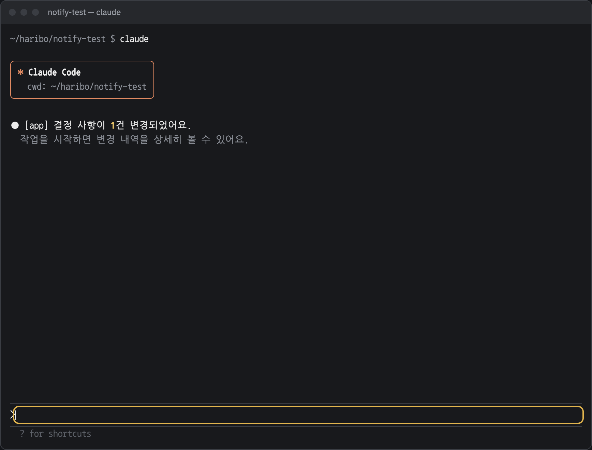

밝은 테마: [보기](screens/web/light/01-켤-때-알림.png)

```
● [app] 결정 사항이 1건 변경되었어요.
  작업을 시작하면 변경 내역을 상세히 볼 수 있어요.
```

### 1-2. 변경 상세와 첫 질문

작업을 입력하면 상세가 뜨고, 바로 아래에서 관계를 물어요. 선택 화면 맨 위 이름표(`#7`)는 답하는 이슈예요.

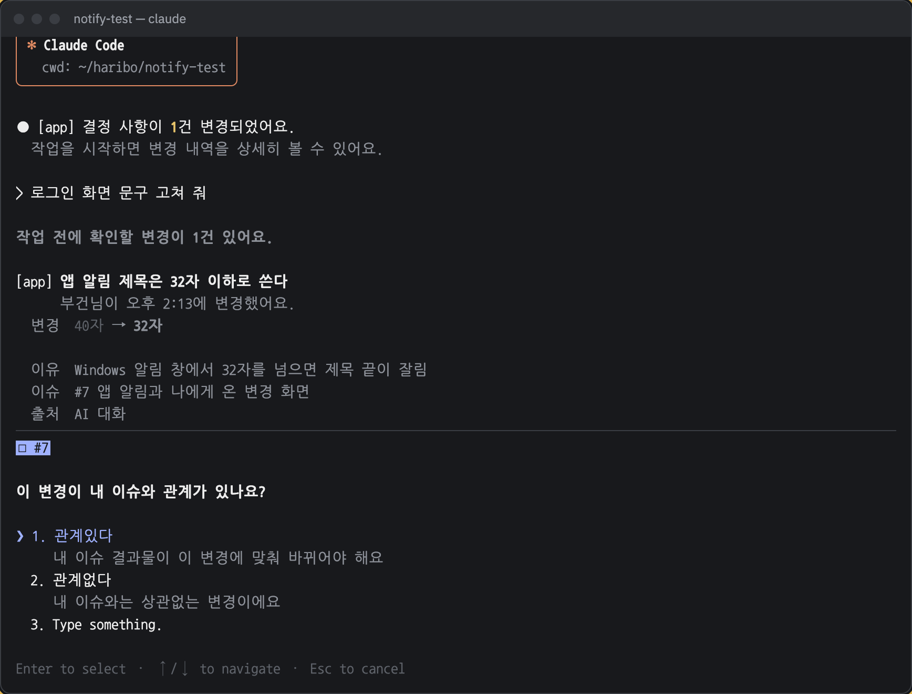

밝은 테마: [보기](screens/web/light/02-상세-숫자-바뀜-관계-질문.png)

```
작업 전에 확인할 변경이 1건 있어요.

[app] 앱 알림 제목은 32자 이하로 쓴다
      부건님이 오후 2:13에 변경했어요.
  변경  40자 ⭢ 32자

  이유  Windows 알림 창에서 32자를 넘으면 제목 끝이 잘림
  이슈  #7 앱 알림과 나에게 온 변경 화면
  출처  AI 대화
```

변경이 여러 건이면 진행 문장 아래에 `1/3` 반전 칩이 붙어요. v1 테스트는 케이스마다 1건이라 칩이 보이지 않았어요.

#### 변경 줄의 네 가지 모양

| 변경 종류      | 변경 줄                                                      | 캡처                                                                                                                         |
| -------------- | ------------------------------------------------------------ | ---------------------------------------------------------------------------------------------------------------------------- |
| 숫자 하나 바뀜 | `변경  40자 ⭢ 32자` (이전은 흐리게, 지금은 굵게)             | 위 캡처                                                                                                                      |
| 문장을 새로 씀 | `변경  문장을 새로 썼어요` + `이전  새 기능은 팀원 2명, …`   | [어두움](screens/web/dark/07-상세-문장-새로-씀-이유-질문.png) · [밝음](screens/web/light/07-상세-문장-새로-씀-이유-질문.png) |
| 새로 생김      | 제목 끝에 `(신규)` + `변경  새로 생긴 결정 사항이에요`       | [어두움](screens/web/dark/09-상세-신규.png) · [밝음](screens/web/light/09-상세-신규.png)                                     |
| 폐기           | 제목 끝에 `(폐기)` + `변경  결정 사항을 폐기했어요` + `이전` | [어두움](screens/web/dark/12-상세-폐기.png) · [밝음](screens/web/light/12-상세-폐기.png)                                     |

v1에는 "지금" 줄이 없어요. 문장을 새로 쓴 변경은 새 내용이 제목에만 들어 있어요.

### 1-3. 두 번째 질문

관계있다를 고르면 알았나를, 관계없다를 고르면 이유를 물어요.

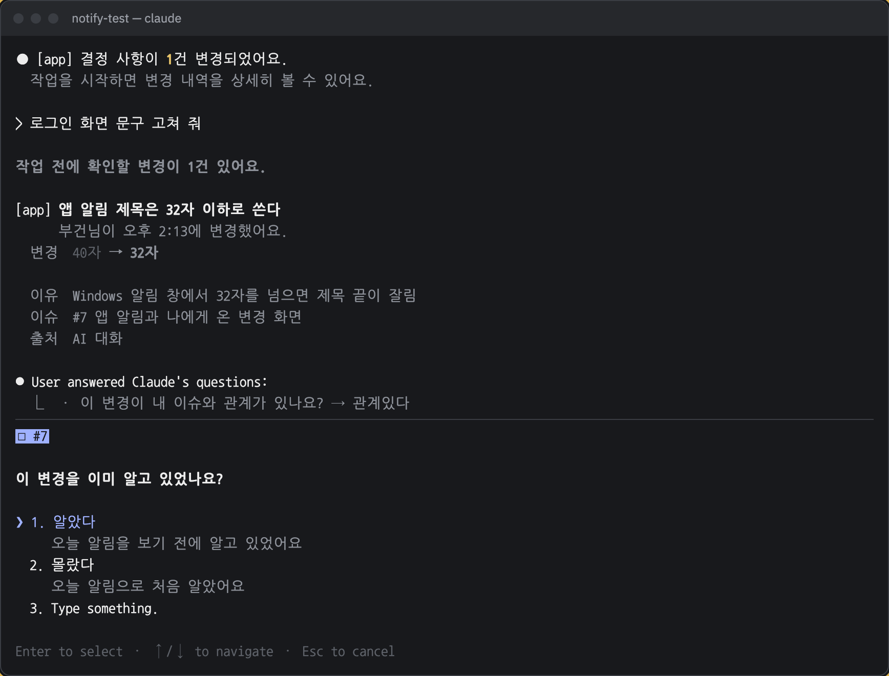

밝은 테마: [보기](screens/web/light/03-알았나-질문.png)

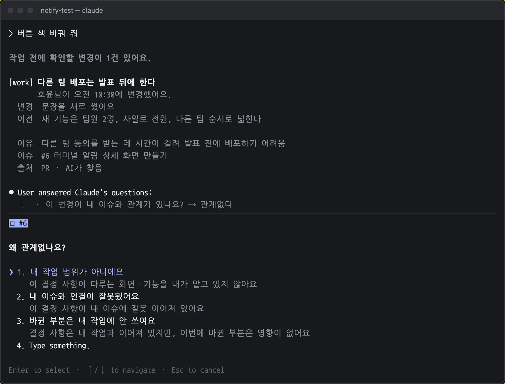

밝은 테마: [보기](screens/web/light/07-상세-문장-새로-씀-이유-질문.png)

| 질문                               | 보기 (설명)                                                                                           |
| ---------------------------------- | ----------------------------------------------------------------------------------------------------- |
| 이 변경이 내 이슈와 관계가 있나요? | 관계있다 (내 이슈 결과물이 이 변경에 맞춰 바뀌어야 해요) · 관계없다 (내 이슈와는 상관없는 변경이에요) |
| 이 변경을 이미 알고 있었나요?      | 알았다 (오늘 알림을 보기 전에 알고 있었어요) · 몰랐다 (오늘 알림으로 처음 알았어요)                   |
| 왜 관계없나요?                     | 내 작업 범위가 아니에요 · 내 이슈와 연결이 잘못됐어요 · 바뀐 부분은 내 작업에 안 쓰여요               |

모든 질문 맨 아래에는 Claude Code가 붙이는 `Type something.`이 있어요.

### 1-4. 보기 대신 직접 쓴 경우

관계·알았나 질문에 직접 쓰면 답으로 기록하지 않아요. Claude가 상세에 있는 내용으로만 한두 문장 답하고 같은 질문을 다시 물어요. 쓴 글은 메모로 남아요.

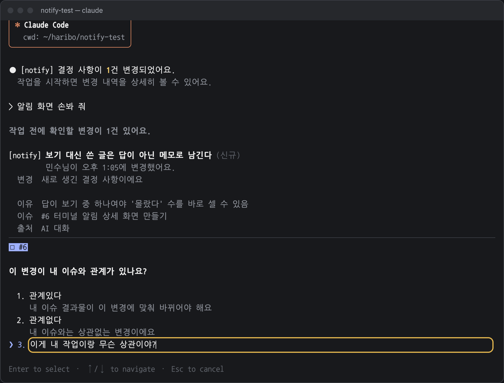

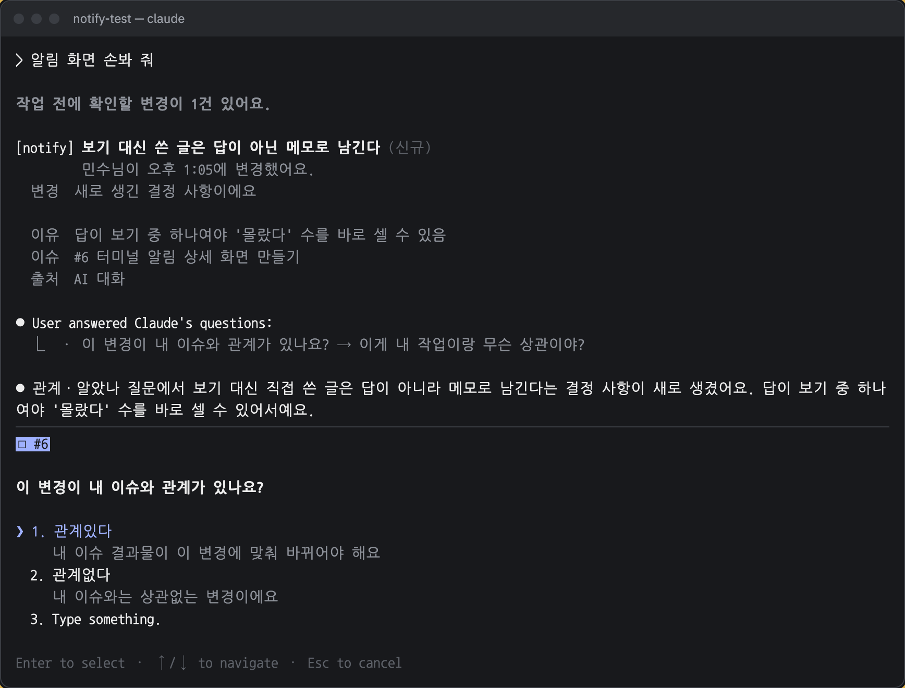

밝은 테마: [직접 쓰기](screens/web/light/10-직접-쓰기.png) · [다시 묻기](screens/web/light/11-직접-쓴-뒤-Claude-답과-다시-묻기.png)

웹 테스트에서는 Claude 답을 변경마다 미리 써 둔 문장으로 보여 줬어요. 실제 시안에서는 Claude가 그때그때 답해요.

### 1-5. 기록 줄

답을 기록하면 상세 바로 아래에 내가 한 답이 떠요. 관계있다일 때만 둘째 줄이 붙어요.

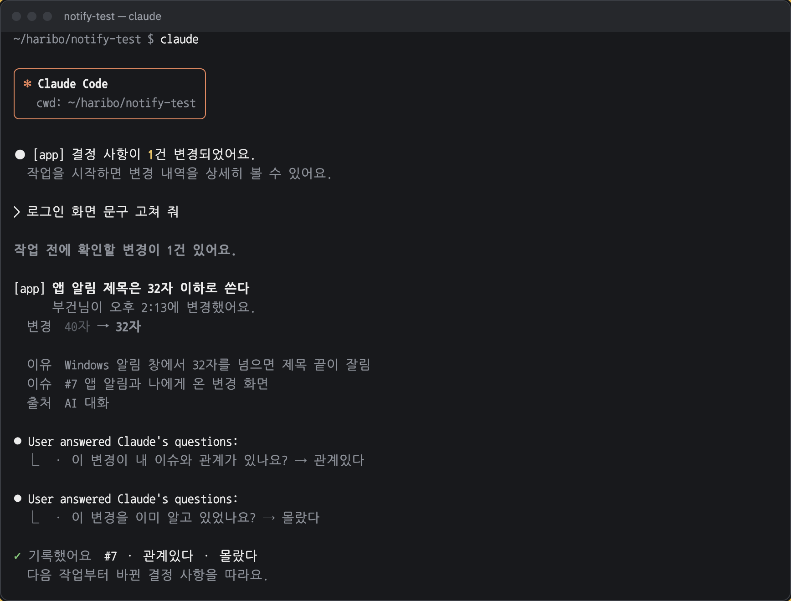

밝은 테마: [보기](screens/web/light/04-기록-줄.png) · 관계없다일 때: [어두움](screens/web/dark/08-기록-줄-관계없다.png) · [밝음](screens/web/light/08-기록-줄-관계없다.png)

```
✓ 기록했어요  #7 · 관계있다 · 몰랐다
  다음 작업부터 바뀐 결정 사항을 따라요.
```

### 1-6. 모두 답한 뒤

```
확인할 변경을 모두 답했어요. 이제 작업을 시작할게요.
```

그다음 Claude가 원래 작업을 이어서 해요.

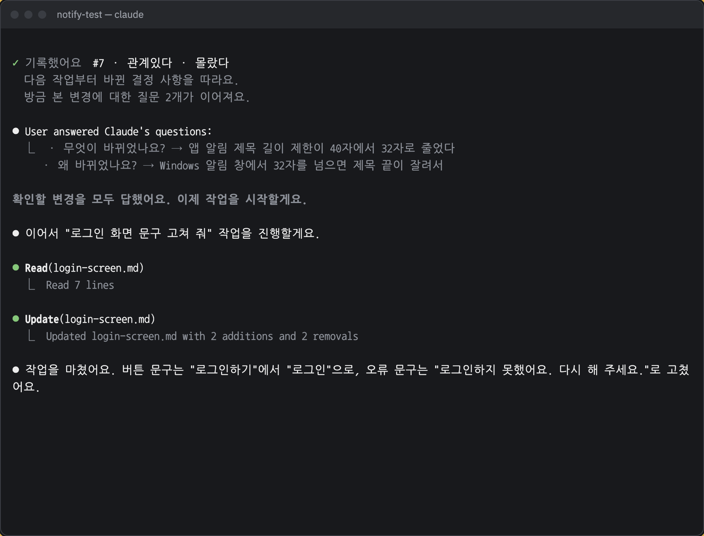

밝은 테마: [보기](screens/web/light/06-모두-답함-작업-시작.png)

웹 테스트의 작업(파일 읽기, 고치기, "작업을 마쳤어요")은 예시 화면이에요.

### 1-7. 닫았다가 나중에 답하기

질문을 Esc로 닫으면 그 세션에서는 다시 묻지 않아요. 대신 작업을 입력할 때마다 한 줄 알림이 떠요.

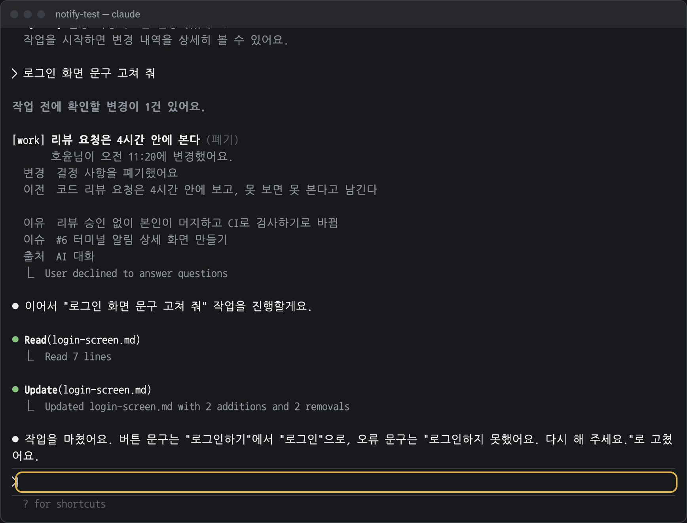

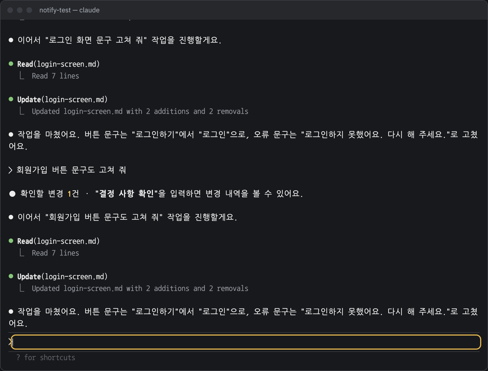

```
● 확인할 변경 1건 · "결정 사항 확인"을 입력하면 변경 내역을 볼 수 있어요.
```

`결정 사항 확인`만 입력하면 상세와 질문이 다시 떠요. 이때 진행 문장에서 "작업 전에"가 빠져요. 답할 변경이 없으면 `✓ 확인할 변경이 없어요.`가 떠요.

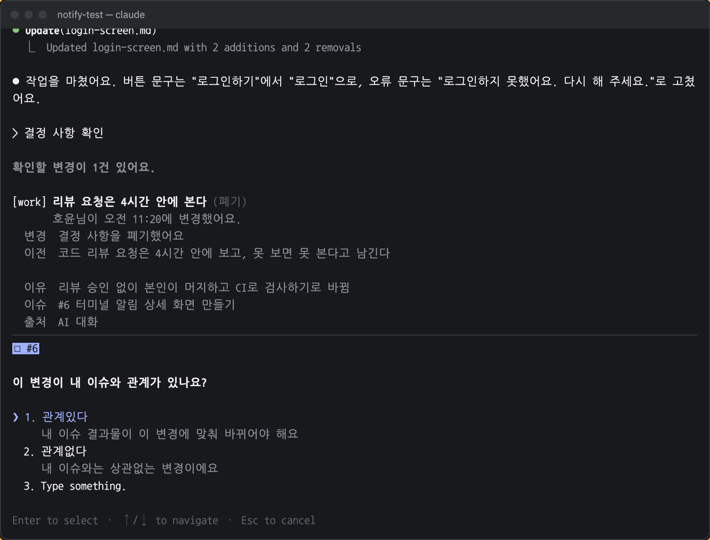

밝은 테마: [닫은 뒤](screens/web/light/13-닫은-뒤.png) · [한 줄 알림](screens/web/light/14-한-줄-알림.png) · [다시 부르기](screens/web/light/15-다시-부르기.png)

### 1-8. 색과 꾸밈

hooks 글은 Claude Code가 회색으로 감싸요. 그 위에 터미널이 테마에 맞춰 바꾸는 색만 썼어요.

| 요소                           | 색·꾸밈                                         |
| ------------------------------ | ----------------------------------------------- |
| 켤 때 알림·한 줄 알림의 첫 줄  | 터미널 기본 글자색 (어두우면 흰색, 밝으면 검정) |
| 건수 숫자                      | 노랑(33) + 굵게                                 |
| 진행 문장                      | 굵게 (회색 안에서)                              |
| 여러 건일 때 `1/3`             | 반전 칩                                         |
| `[영역]`과 제목                | 기본 글자색, 제목만 굵게                        |
| `(신규)`·`(폐기)`              | 흐리게                                          |
| 바꾼 사람·시간, 이유·이슈·출처 | Claude Code 기본 회색                           |
| 변경 줄의 이전 값 / 지금 값    | 흐리게 / 굵게                                   |
| `✓`                            | 초록(32)                                        |

### 1-9. 테스트에만 있었던 것

실제 시안에는 없고, 웹 테스트 페이지에만 있던 것들이에요. 피드백을 읽을 때 걸러서 봐야 해요.

- **이해 질문:** 케이스 1·2에서 답한 뒤 상세를 가리고 "무엇이 바뀌었나요?", "왜 바뀌었나요?"를 물었어요. ([캡처](screens/web/dark/05-테스트-이해-질문.png))
- **"지금 할 일" 안내 띠와 케이스 소감:** 터미널 아래 노란 띠예요. 캡처에는 터미널만 담았어요.
- **입력 칸의 노란 테두리:** 웹 페이지의 포커스 표시가 그대로 보였어요 ([캡처](screens/web/dark/14-한-줄-알림.png) 맨 아래). 실제 Claude Code에는 없어요.
- **Claude 응답:** 기다리는 시간(`✻ Thinking…`)과 답을 고정해 흉내 냈어요.

### 1-10. 실제 터미널 시안 화면

`notice.py`가 실제로 내보내는 hooks 글(색 코드 포함)을 [`prototype/theme-preview.py`](../prototype/theme-preview.py)와 같은 규칙으로 그렸어요. 테스트 모드가 아닌 실제 흐름이고, `changes-test.json` 3건을 한 세션에서 이어서 답하는 경우예요.

선택 화면은 Claude Code가 직접 그리기 때문에 근사로 그렸어요. 터미널 색도 터미널 앱 팔레트에 따라 달라질 수 있어요. 진짜 Claude Code 캡처는 아니라는 점을 감안해서 봐 주세요.

#### 켤 때 알림 (여러 영역, 여러 건)

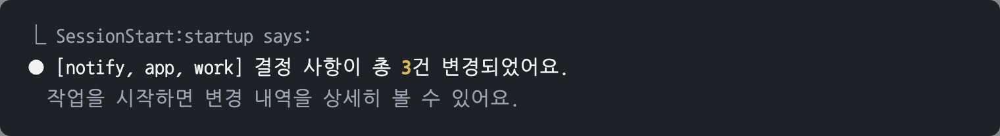

밝은 테마: [보기](screens/terminal/light/01-켤-때-알림.png)

#### 상세 1/3과 질문

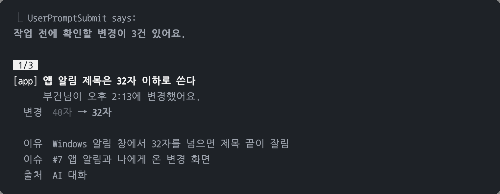

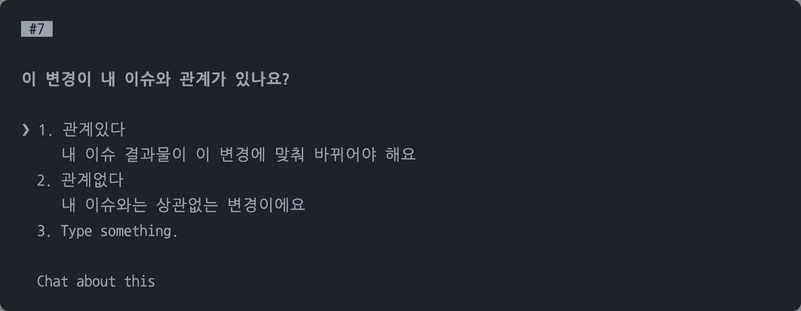

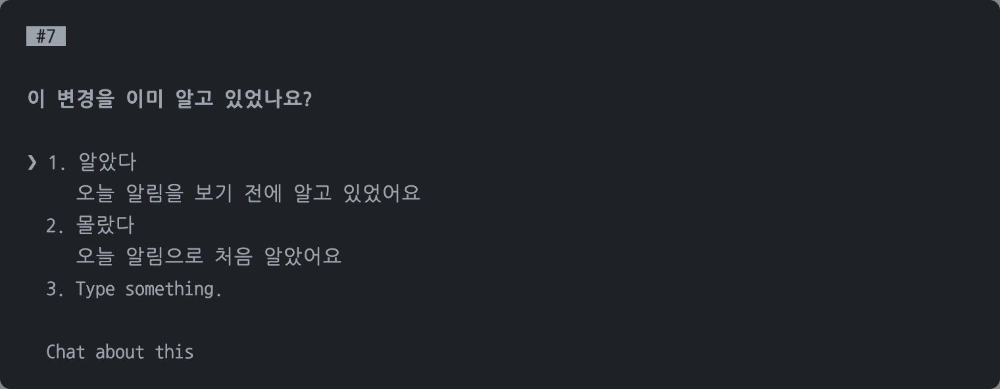

밝은 테마: [상세](screens/terminal/light/02-상세-1of3.png) · [관계 질문](screens/terminal/light/03-관계-질문.png) · [알았나 질문](screens/terminal/light/04-알았나-질문.png)

#### 기록 줄 바로 아래에 다음 상세

답을 기록하면 기록 줄과 다음 변경 상세가 한 번에 떠요. 진행 문장은 "남았어요"로 바뀌어요.

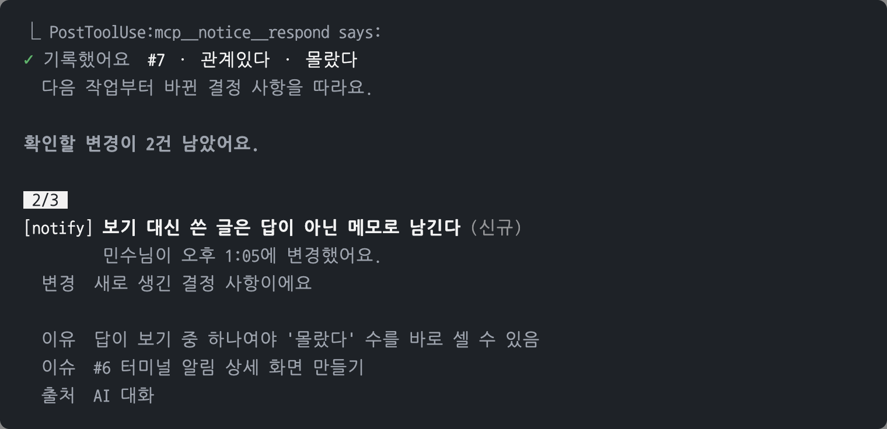

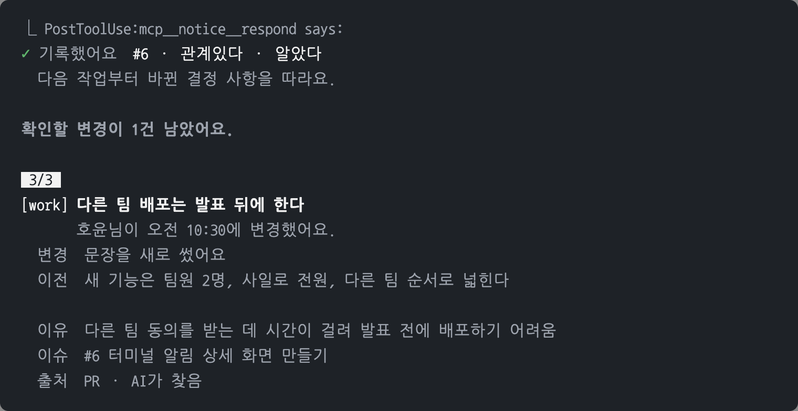

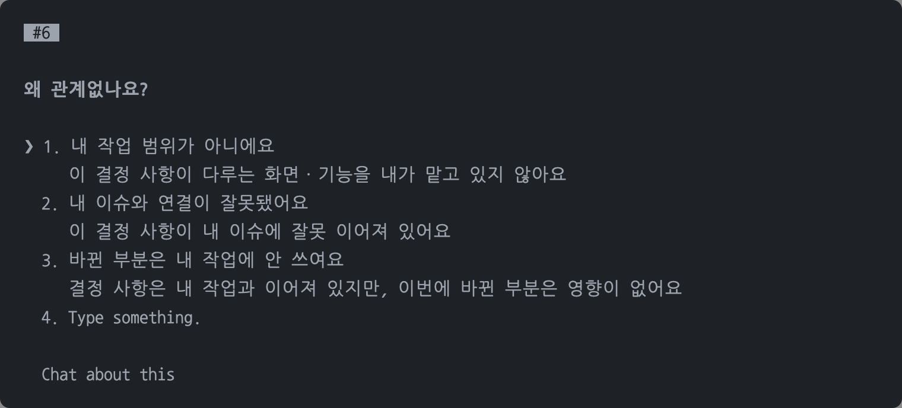

밝은 테마: [2/3](screens/terminal/light/05-기록-줄과-다음-상세-2of3.png) · [3/3](screens/terminal/light/06-기록-줄과-다음-상세-3of3.png) · [이유 질문](screens/terminal/light/07-이유-질문.png)

#### 모두 답한 뒤, 닫은 뒤, 다시 부를 때

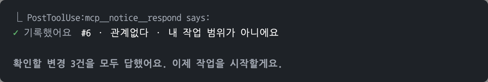

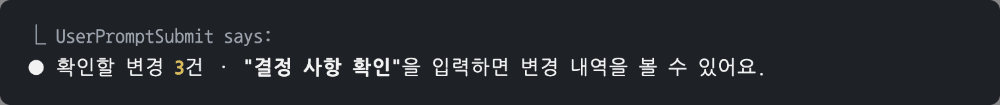

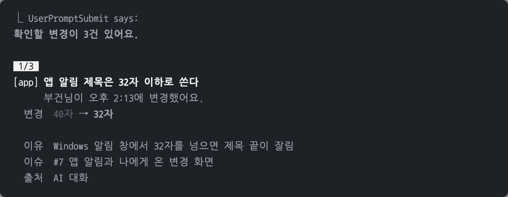


밝은 테마: [모두 답함](screens/terminal/light/08-모두-답함.png) · [한 줄 알림](screens/terminal/light/09-닫은-뒤-한-줄-알림.png) · [다시 부르기](screens/terminal/light/10-다시-부르기.png) · [없음](screens/terminal/light/11-확인할-변경-없음.png)

#### 웹 테스트 화면과 다른 점

피드백을 v2에 반영할 때 함께 봐야 해요.

| 실제 터미널 시안                                                     | 웹 테스트 (참가자가 본 화면)       | 영향                                                                            |
| -------------------------------------------------------------------- | ---------------------------------- | ------------------------------------------------------------------------------- |
| hooks 글 위에 `⎿ SessionStart:startup says:` 같은 머리줄이 붙어요    | 머리줄이 없어요                    | 알아차림 피드백("다른 글과 섞여 몰랐다")이 실제 화면에서도 같은지 확인해야 해요 |
| 한 세션에 여러 건: `총 3건`, `2/3` 반전 칩, "N건 남았어요"           | 케이스마다 1건이라 칩이 안 보여요  | 여러 건이 이어지는 흐름은 테스트하지 못했어요                                   |
| 기록 줄 바로 아래에 다음 상세가 이어서 떠요                          | 케이스마다 Claude Code를 다시 켜요 | 상세가 연달아 쌓일 때 읽기 부담은 확인하지 못했어요                             |
| 선택 화면에 `Chat about this`가 있어요                               | 없어요                             | 보류하고 싶을 때(P3 의견) 이 보기를 쓸지는 확인하지 못했어요                    |
| 다 답하면 `확인할 변경 3건을 모두 답했어요. 이제 작업을 시작할게요.` | 작업 내용까지 예시로 보여 줘요     | 없음                                                                            |

---

## 2. 어떻게 만들었나

### 터미널 시안

- 위치: `cli-design-notes/prototype/notify-prototype` (켜는 법은 [prototype/README.md](../prototype/README.md))
- 화면 글은 `proto/notice.py`가 만들고, hooks가 띄워요. 켤 때(SessionStart), 작업 입력 때(UserPromptSubmit), 답 기록 뒤(PostToolUse)예요.
- 질문은 Claude가 `AskUserQuestion`으로 물어요. 답은 시안용 MCP(`proto/mcp_server.py`)의 `respond`로 기록해요.

### 터미널 사내 테스트 스크립트 (`test_run.py`)

- 위치: `prototype/notify-prototype/test_run.py` (설계: [SIL-68-사내테스트-자동화-설계](../SIL-68-사내테스트-자동화-설계.md), 진행: [SIL-68-사내테스트-진행대본](../SIL-68-사내테스트-진행대본.md))
- 진행자가 참가자 정보를 입력하면 진짜 Claude Code를 테스트 모드(`NOTICE_TEST=1`)로 켜요. 참가자가 시안 3건에 답하면 Claude Code를 닫고 설문을 받아 `results/`에 남겨요.
- 테스트 모드에서만 하는 일: 사건 시각을 `.events.jsonl`에 남기고, 답할 때마다 상세를 빈 줄로 밀어낸 뒤 이해 질문 3개를 물어요.
- 진행자가 옆에서 보며 소리 내어 말한 것을 적는 방식이라, 한 사람씩 진행해요.

### 터미널 테스트에서 웹 테스트로 옮긴 이유

실제 테스트는 웹 테스트 페이지로 했어요. `test_run.py`로는 10/12 12:15에 시험 삼아 한 번 돌렸고, 기록은 비어 있어요.

- 진행자 없이 링크 하나로 여러 명이 동시에, 각자 자리에서 할 수 있어요.
- 결과가 진행자 컴퓨터가 아니라 한곳에 모이고, CSV로 바로 받을 수 있어요.
- 대신 진짜 터미널에서 보이는 모양(줄바꿈, 테마 색, Claude Code 선택 화면)과, 옆에서 지켜보며 얻는 말은 포기했어요.

| 항목        | `test_run.py` (터미널)                                        | 웹 테스트 페이지 (실제로 돌린 것)                                                |
| ----------- | ------------------------------------------------------------- | -------------------------------------------------------------------------------- |
| 화면        | 진짜 Claude Code + hooks + 시안 MCP                           | 웹에서 흉내 낸 화면                                                              |
| 진행        | 진행자가 옆에서, 한 사람씩                                    | 링크로 혼자, 여러 명 동시에                                                      |
| 변경        | 한 세션에 3건 이어서                                          | 케이스 4개, 케이스마다 1건 (고를 답을 안내)                                      |
| 이해 질문   | 변경마다 3개 (직접 쓰기 → 무엇이 → 왜)                        | 케이스 1·2에서만 2개 (무엇이 → 왜)                                               |
| 마지막 질문 | 5개 (쉬웠나, 다시 답할까, 걸린 시간, 헷갈린 말, 하고 싶은 말) | 6개 (알아차림, 이해, 막힌 순간, 귀찮음, 헷갈린 말, 개선 의견) + 부정적 답의 까닭 |
| 결과        | 진행자 컴퓨터의 `results/` (GitHub에 올리지 않음)             | 아티팩트 저장소 → CSV                                                            |

### 웹 테스트 페이지

- 위치: [`web-test/index.html`](web-test/index.html) (claude.ai 아티팩트로 올려 사용. 결과는 아티팩트 저장소에 쌓이고, 파일만 열면 저장할 수 없다는 안내가 떠요)
- 터미널 시안의 화면 글과 질문 순서를 웹에서 흉내 냈어요. 설치 없이 링크 하나로 혼자 진행할 수 있어요.
- 진행 순서: 참가자 정보 → 안내 → 케이스 4개 → 마지막 질문 6개

| 케이스 | 해 볼 것                 | 변경 (종류)                               |
| ------ | ------------------------ | ----------------------------------------- |
| 1      | 관계있다 → 알았다/몰랐다 | 앱 알림 제목 40자 → 32자 (숫자 하나 바뀜) |
| 2      | 관계없다 → 이유          | 다른 팀 배포는 발표 뒤에 (문장을 새로 씀) |
| 3      | 직접 써서 물어보기       | 보기 대신 쓴 글은 메모로 (신규)           |
| 4      | 닫은 뒤 다시 답하기      | 리뷰 요청은 4시간 안에 본다 (폐기)        |

- 변경 1~3은 `prototype/notify-prototype/proto/changes-test.json`, 4는 위키의 리뷰 규칙 폐기(`work.review.within-4h` → `work.review.self-merge`)를 썼어요.
- 자동으로 남긴 것: 사건마다 시각, 고른 답, 직접 쓴 글, 닫은 횟수, 다시 돌아온 시간, 힌트를 봤는지, 이해 질문 정답, 케이스별 매끄러움(1~5)과 소감.
- 마지막 질문: ① 알아차림 ② 이해 ③ 가장 막힌 순간 ④ 고르는 과정이 귀찮았는지 ⑤ 헷갈린 말 ⑥ 개선 의견. ①~④에서 부정적으로 답하면 까닭을 골라요.

---

## 3. 이렇게 만든 이유

근거 문서: 흐름 = [터미널-알림-흐름-결정기록](../터미널-알림-흐름-결정기록.md), 첫줄 = [T2-첫줄](../T2-첫줄-결정기록.md), 본문 = [T2-본문](../T2-본문-결정기록.md), T3 = [T3-질문과-답](../T3-질문과-답-결정기록.md)

| 화면 요소                       | 정한 것                                  | 이유                                                                                                                            | 근거           |
| ------------------------------- | ---------------------------------------- | ------------------------------------------------------------------------------------------------------------------------------- | -------------- |
| 켤 때 알림                      | 세션 시작에 건수만, 상세는 작업 입력 뒤  | 작업 전에 알아야 재작업을 막아요. Claude Code는 사용자가 먼저 입력하기 전에는 말을 걸 수 없고, hooks 글은 키 입력을 받지 못해요 | 흐름 1장, 5-1  |
| `[영역]` 대괄호, 3개까지        | 첫 줄 맨 앞에 이름표로                   | 사람들은 줄의 처음 두 단어를 가장 많이 봐요. 3개를 넘게 나열하면 80칸을 넘어요                                                  | 첫줄 3-3, 3-8  |
| 건수 숫자 노랑 + 굵게           | 노랑(33)                                 | 노랑은 "주의해서 볼 대기 중인 것"이에요. 숫자 한 글자만 색을 바꾸면 조용해서 굵게를 함께 써요                                   | T3 5-9         |
| 진행 문장 + 반전 칩             | "확인할 변경이 N건 있어요/남았어요"      | 칸 막대는 2건이 하나처럼 보였고, 숫자가 두 번 나왔어요. 반전 칩은 어느 테마에서도 대비가 생겨요                                 | 흐름 8-4, 5-7  |
| 변경 줄 요약(E)                 | 바뀐 부분만 `40자 ⭢ 32자`                | 받는 사람에 디자이너가 섞여 있고 1분 안에 판단해야 해요. 두 줄 비교는 눈이 오가야 해요                                          | 흐름 5-5       |
| "지금" 줄 뺌                    | 새 내용은 제목으로                       | 핵심이 제목에 다 들어가 있다고 봤어요. 위키 `notify.terminal.show-fields`와 다른 점은 확인할 거리로 남겼어요                    | 흐름 5-11, 7장 |
| 화살표 `⭢`                      | `→` 대신                                 | `→`는 한국어 설정에서 2칸이 될 수 있고 `⭢`는 어디서나 1칸이에요                                                                 | 흐름 5-10      |
| 지금 값 굵게                    | 형광펜에서 바꿈                          | 10/12 부건이 정했어요. 굵게는 덜 튀어서 실제 화면에서 확인이 필요하다는 메모가 있어요                                           | 흐름 5-8       |
| 출처 `AI 대화`·`PR · AI가 찾음` | 꾸밈 없는 글자                           | 칩으로 하면 색이 어수선해요. 출처 이름은 아직 미정(경하님 확인)이에요                                                           | 흐름 4장, 9장  |
| 질문 두 단계                    | 관계 → 알았나(또는 이유), 추천 표시 없음 | 위키 `notify.answer.two-questions`를 따랐어요. 핵심 지표(몰랐다)는 사람의 판단이어야 해요                                       | 흐름 1장       |
| 이름표 = 이슈 번호              | `#7`                                     | 같은 변경이 두 이슈에 걸리면 어느 이슈에 답하는지 보여야 해요                                                                   | T3 5-2         |
| "오늘 알림을 보기 전에"         | 알았다/몰랐다 설명                       | 두 번째 이슈 화면에서 "방금 봤으니 알았다"로 답해 몰랐다가 적게 잡히는 걸 막아요                                                | T3 5-4         |
| 직접 쓴 글은 메모               | 답으로 기록하지 않음                     | 답이 보기 중 하나여야 몰랐다 수를 바로 셀 수 있어요. `Type something.`은 우리가 뺄 수 없어요                                    | T3 5-6         |
| 기록 줄                         | `✓ 기록했어요  #7 · 관계있다 · 몰랐다`   | 착수 문서가 "내가 한 답"을 보여 주라고 해요. 문장으로 쓰면 길고 어색해요. 둘째 줄은 위키 `next-run-context`에 맞췄어요          | T3 5-5, 5-10   |
| 닫으면 한 줄 알림만             | 작업마다 한 줄                           | 매번 다시 띄우면 급한 작업이 막히고, 아무것도 안 띄우면 답을 못 받아요                                                          | T3 5-7         |
| `결정 사항 확인`                | 입력 전체가 같을 때만 다시 부름          | `변경 확인`은 개발 중에 다른 뜻으로 입력될 수 있어요. 말로 부탁하기와 슬래시 명령은 버렸어요                                    | T3 5-8         |
| `✓ 확인할 변경이 없어요.`       | 다시 불렀는데 남은 게 없을 때            | 직접 불렀는데 반응이 없으면 고장으로 보여요                                                                                     | 첫줄 5장       |
| 용어 "결정 사항", "확인할 변경" | 위키 v1의 "기준" 대신                    | 착수 문서와 SIL-71이 이미 "결정 사항"을 써요. 위키 `copy.term.standard`도 10/12 SIL-83에서 "결정 사항"으로 고쳤어요             | T3 5-11        |
| 기본 16색만                     | 흰색·검정을 직접 고르지 않음             | hooks는 터미널 배경색을 물어볼 수 없어요. 추측했더니 검정 글자가 칠해졌어요                                                     | 흐름 5-9       |

---

## 4. 받은 피드백

### 참가자

2026-10-12에 8번 시작했고, 끝까지(마지막 질문까지) 진행한 3명만 분석했어요. 이름은 쓰지 않아요 (사내 테스트 결과는 GitHub에 올리지 않기로 함, [자동화 설계 6장](../SIL-68-사내테스트-자동화-설계.md)).

| 참가자 | 직군   | 사일로 | 테마   | 전체 시간 |
| ------ | ------ | ------ | ------ | --------- |
| P1     | 디자인 | 사일로 | 어두움 | 8분 28초  |
| P2     | 개발   | 사일로 | 어두움 | 13분 29초 |
| P3     | 개발   | 사일로 | 어두움 | 9분 6초   |

세 명 모두 사일로 사람이라 이해도가 실제보다 높게 나올 수 있어요. 사람 수가 적어서 숫자는 방향만 봐요. 나머지 5번은 중간에 멈췄어요(진행 중 2, 그만둠 2, 정보만 입력 1).

### 숫자

| 항목                            | P1         | P2             | P3              | 진행 대본 기준과 비교                                 |
| ------------------------------- | ---------- | -------------- | --------------- | ----------------------------------------------------- |
| 판단 시간 중간값                | 53.8초     | 56.5초         | 18.2초          | 1분 안이지만 아슬아슬해요                             |
| 60초 넘은 답                    | 4건 중 2건 | 4건 중 1건     | 4건 중 1건      | 넘은 4건 중 3건은 케이스 3·4 (직접 쓰기, 닫을지 고민) |
| 이해 질문 무엇이 / 왜 (답한 것) | 2/2 · 2/2  | 2/2 · 1/2      | 1/1 · 1/1       | 무엇이 5건 중 5건, 왜 5건 중 4건으로 기준(80%) 넘음   |
| 알아차림 (1~5)                  | 3          | 3              | 4               | 가장 낮아요                                           |
| 이해 (1~5)                      | 5          | 1              | 4               | 사람마다 크게 갈려요                                  |
| 덜 귀찮음 (1~5)                 | 5          | 4              | 2               |                                                       |
| 닫았다가 다시 돌아오기          | 닫지 못함  | 힌트 없이 28초 | 힌트 보고 154초 | 닫은 2명 중 1명만 혼자 돌아왔어요                     |

- 케이스 3의 판단 시간(94~176초)은 직접 쓰고 답을 읽는 시간이 들어 있어서 1분 기준과 견주지 않아요.
- P3은 케이스 2의 이해 질문을 닫아서 답이 없어요.

### 참가자 의견

**알아차리기 어려웠어요** (알아차림 3점인 2명이 모두 "다른 글과 섞여 알림인지 몰랐다"를 골랐어요)

- P1: "다른 내용과 어느 정도 알림이라는 구분이 있긴 해야 할 것 같습니다"
- P2: 회색 글씨라 눈에 잘 띄지 않았다, 작업을 입력하기 전까지 못 봤다. "변경 사항이 좀 더 눈에 잘 들어오게 변경되면 좋을 거 같아요"
- P1: 질문을 닫은 뒤 뜬 한 줄 알림을 못 봤다

**무엇이 바뀌었는지 한눈에 안 들어왔어요**

- P2 (이해 1점): "변경" 줄만으로는 무엇이 바뀌었는지 몰랐다, 이전 값과 지금 값을 견주기 어려웠다, 이유가 짧아 왜 바뀌었는지 몰랐다, 내 이슈와 어떻게 이어지는지 몰랐다. 가장 막힌 순간으로는 관계 고르기를 꼽았어요. "변경 내용을 이해하기 어려워 고르기에 막혔음"
- P1: 가장 막힌 순간으로 변경 내용 읽기를 꼽았어요. 읽을 글이 많았다, 화면이 갑자기 바뀌었다

**바로 답할 수 없을 때 고를 보기가 없었어요**

- P3: 이유 칸에 "확인 후에 판단할게요"를 직접 썼어요. "판단을 보류해야 하는 상황이나, 그 사람과 논의한 뒤 결정해야 하는 경우 어떻게 처리되어야 할지 궁금합니다"
- P3: 가장 막힌 순간은 알았다/몰랐다 고르기였어요(보기가 내 생각과 맞지 않았다). 관계가 있는지 판단하기 어렵고, 알았다/몰랐다를 정하기 애매했다고 했어요

**닫아도 되는지, 잘못 고르면 고칠 수 있는지 몰랐어요**

- P1 (케이스 4): "닫으면 안 될 것 같아서 못 닫았어요. 터미널은 답을 잘못 입력했을 때 뒤로 되돌아갈 수 없다 보니 이런 경우 난감할 것 같다"

**"결정 사항 확인"으로 돌아오기 어려웠어요**

- P3: "결정 사항 확인이라고 입력했을 때 나오는 걸 제대로 확인하지 못했습니다". 헷갈린 말로도 꼽았어요
- P3: "터미널에서 다음 입력을 대강 먼저 제시해 주는 기능을 활용해 결정 사항 확인을 유도하면 더 좋을 것 같습니다"

**팀 전체 규칙은 "내 이슈"와 맞지 않았어요**

- 케이스 4(리뷰 규칙 폐기)는 정답을 "관계있다"로 넣었는데, 3명 중 2명이 "관계없다 · 내 작업 범위가 아니에요"를 골랐어요. 질문이 "내 이슈 결과물이 바뀌어야 해요"라서, 일하는 방식 규칙에는 관계없다가 자연스러워요.

**헷갈린 말** (한 명씩이라 신호는 약해요)

- P1: `(신규)`·`(폐기)`, 관계없는 이유 보기, "다음 작업부터 바뀐 결정 사항을 따라요"
- P3: "결정 사항 확인"

---

## 5. 그래서 어떻게 개선할까

### 바로 고칠 것 (팀 결정 사항은 그대로)

| #   | 문제                          | 개선안                                                                                                                   | 근거 피드백 |
| --- | ----------------------------- | ------------------------------------------------------------------------------------------------------------------------ | ----------- |
| 1   | 알림이 다른 글과 섞여 안 보임 | 상세 위아래에 구분선과 머리표를 넣어요. 1건일 때도 반전 칩을 보여 줘요. 회색 감싸기 제약이 있어 색보다 모양으로 구분해요 | P1, P2      |
| 2   | 무엇이 바뀌었는지 안 들어옴   | "지금" 줄을 되살려요. 위키 `notify.terminal.show-fields`(이전 값·지금 값)로 돌아가는 거라 결정 사항 변경이 아니에요      | P2          |
| 3   | 닫아도 되는지 모름            | 질문 위에 "Esc로 닫고 나중에 답할 수 있어요" 한 줄을 넣어요                                                              | P1          |
| 4   | 다시 돌아오기 어려움          | 한 줄 알림에서 입력할 말을 더 눈에 띄게 해요. Claude Code의 입력 제안을 hooks로 띄울 수 있는지 확인해요(지금은 모름)     | P3          |

### 팀이 정할 것 (팀 결정 사항이 바뀌어요)

| #   | 문제                                  | 정할 것                                                                                                       | 걸린 결정 사항                                       |
| --- | ------------------------------------- | ------------------------------------------------------------------------------------------------------------- | ---------------------------------------------------- |
| 5   | 바로 답할 수 없을 때 고를 보기가 없음 | "나중에 답할게요" 보기를 더할지, 닫기를 그 역할로 안내할지. 더하면 몰랐다 수를 세는 방식이 바뀌어요           | `notify.answer.two-questions`, `goal.metric.primary` |
| 6   | 잘못 고른 답을 고칠 길이 없음         | 관계없다 취소만 있는 지금 규칙을 넓힐지                                                                       | `notify.answer.cancel`                               |
| 7   | 팀 전체 규칙은 "내 이슈"와 안 맞음    | `work` 영역 같은 일하는 방식 변경을 이슈별로 묻지 않고 팀 전체에 알릴지. 그대로 두면 관계없다 비율이 부풀어요 | `goal.guard.unrelated-rate`                          |

### 테스트 페이지에서 고칠 것

- 입력 칸의 노란 테두리를 없애요.
- "화면이 갑자기 바뀌었다"가 이해 질문 전에 상세를 가리는 장치 때문인지 확인해요.
- 케이스 4의 정답(관계있다)을 다시 정해요.
- 8번 중 5번이 끝까지 가지 못한 까닭을 참가자에게 물어봐요.
- 여러 건이 한 세션에 이어지는 흐름(`2/3` 칩, "남았어요")과 `Chat about this`를 테스트에 넣어요 ([1-10](#1-10-실제-터미널-시안-화면)).

---

## 파일

| 파일                                  | 내용                                                    |
| ------------------------------------- | ------------------------------------------------------- |
| `README.md`                           | 이 문서                                                 |
| `screens/web/{dark,light}/*.png`      | 참가자가 본 웹 테스트 화면 캡처 15장씩 (1-1~1-9)        |
| `screens/terminal/{dark,light}/*.png` | 실제 hooks 글로 그린 터미널 시안 화면 11장씩 (1-10)     |
| `web-test/index.html`                 | v1 웹 테스트 페이지 사본 (claude.ai 아티팩트로 올려 씀) |
